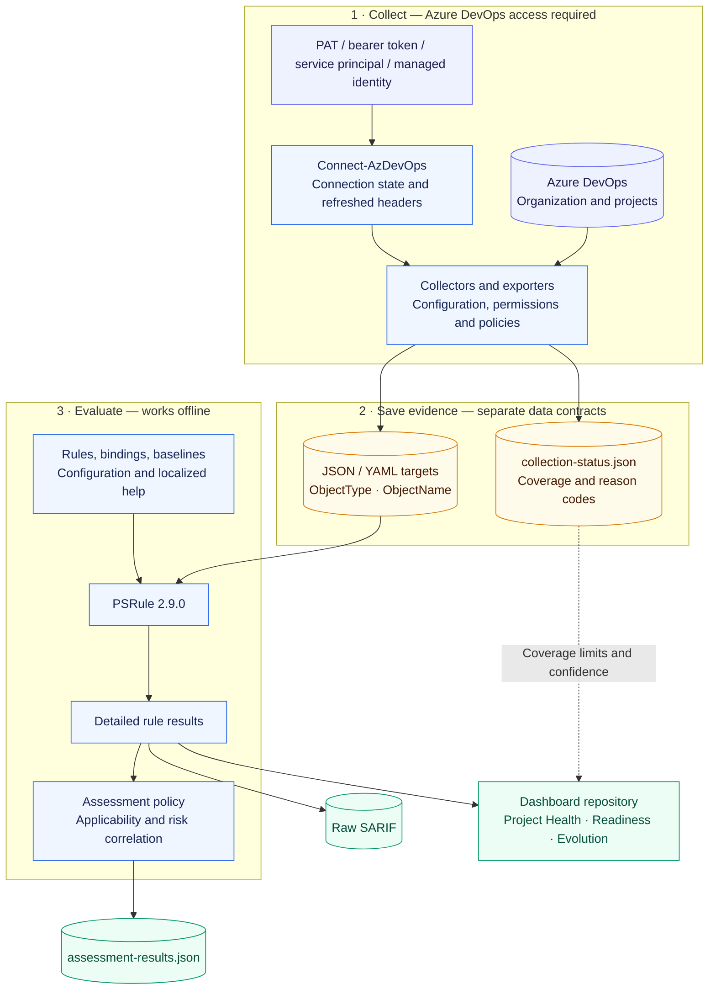
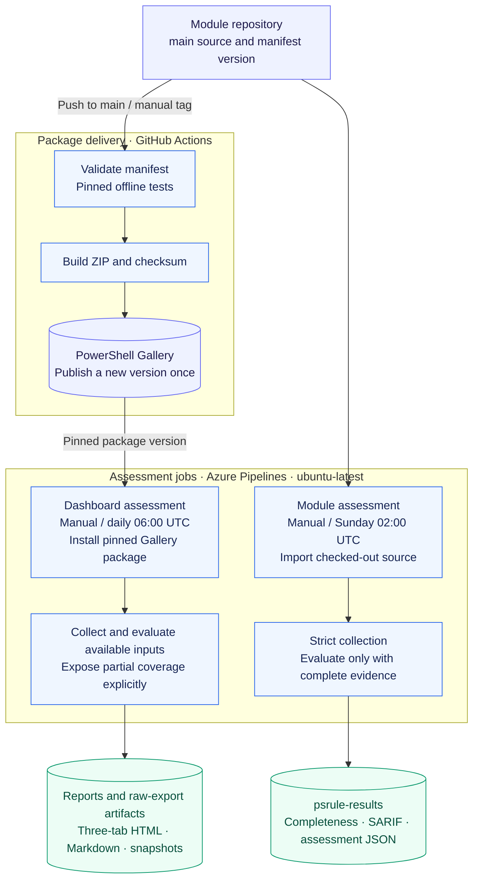

# Repository architecture

This document describes the module source and assessment contracts on 25 October 2026.
Pipeline definitions describe intended execution. They do not prove that a pipeline, service connection, or Azure resource currently exists.
The [Project Health integration guide](project-health.md) retains historical live
validation. The dashboard reporter is now integrated in its repository; source
integration alone does not establish that a live pipeline definition was updated.

## Scope and requirements

The system collects Azure DevOps configuration, evaluates security rules, and presents the results to operators.
It supports project assessments and organization assessments. Operators can evaluate exported data without another connection to Azure DevOps.

The main requirements visible in the implementation are:

- Support multiple authentication methods and permission profiles.
- Bind exported objects to stable rule types and target names.
- Record collection gaps separately from rule failures.
- Provide configurable baselines and localized rule help.
- Publish assessment evidence in pipeline artifacts.
- Present a run snapshot in Azure DevOps and historical results in Azure Monitor.

The source does not define an assessment latency target, throughput target, or service availability objective.
Assessment duration depends on project count, API calls, agent capacity, and ingestion delay.

## Workspace boundaries

The container workspace is not a Git repository. It contains two independent repositories.

| Directory | Responsibility |
| --- | --- |
| `PSRule.Rules.AzureDevOps/` | PowerShell module, collectors, rules, tests, and module delivery pipelines. |
| `PSRule.Dashboards.AzureDevOps_/` | Assessment scripts, pipeline reports, Bicep resources, and Azure Monitor Workbooks. |
| Each repository's `.worktrees/` | Isolated development checkouts; these are not production components. |
| `.agents/` | Shared development workflows. It is not part of the assessment runtime. |

Dashboard paths below refer to the dashboard repository root. Rule paths refer to this repository root.
The [dashboard architecture](../../PSRule.Dashboards.AzureDevOps_/docs/architecture.md) describes its runtime and report contracts.
That cross-repository link works in this workspace. It requires the same directory layout when used elsewhere.

## Component and data flow

Collection requires Azure DevOps access. Saved targets can be evaluated offline.
Coverage metadata stays outside rule inputs and informs report confidence; it is
not a rule target. Report presentation belongs to the dashboard repository.

### Module loading and authentication

The manifest and loader reside in `src/DevOpsTools.AzureDevOps.PSRule/`.
The loader initializes module connection state and imports scripts from `Classes/` and `Functions/`.
PSRule discovers the rule definitions under `rules/`.

`Connect-AzDevOps` creates an `AzureDevOpsConnection` instance and stores it in module state.
Collectors use this connection for authentication. The class supports PAT, bearer, service-principal, and managed-identity authentication.
Token refresh and header construction belong to the connection class.

`FullAccess`, `ReadOnly`, and `FineGrained` describe permission profiles. These profiles are distinct from authentication methods.
Collectors can report unavailable coverage when a profile cannot access a required API.

### Collection and export

`Functions/DevOps.<Area>.ps1` groups retrieval and export functions by Azure DevOps object type.
The module loader also defines the aggregate project and organization exporters.
Project export dispatches collectors for repositories, policies, pipelines, environments, groups, service connections, variable groups, and organization settings.
Organization export discovers projects and creates a directory for each project.

Aggregate export attempts the remaining collectors after a collector fails.
Collection status records distinguish successful collection, empty collections, restricted coverage, and failed collection.
With `-Strict`, aggregate export rejects incomplete required coverage after collecting available evidence.
The completeness report must remain outside the rule input directory.

See [assessment completeness](assessment-completeness.md) for the status schema and reason codes.

### Rule input contract

Exported objects carry `ObjectType` and `ObjectName` properties.
`rules/Config.Rule.yaml` binds `ObjectType` to the PSRule target type.
It prefers `ObjectName` for the target name, with `name`, `displayName`, and `id` as fallback properties.
The binding also exposes `id` and `name` as result fields.

Rule scripts declare their target type, identifier, level, and tags.
Baselines select applicable rules and configuration defaults. Caller configuration can override thresholds.
English help resides in `en/`. Dutch help resides in `nl/` and does not cover every rule.

The exported JSON is the boundary between collection and evaluation.
Changes to object metadata can affect rule selection, target identity, tests, and workbook filters.

## Delivery and assessment pipelines

The module publication workflow runs on pushes to `main` and can also validate
an explicit version tag manually. It validates the manifest, runs pinned offline
tests, builds the package and checks the Gallery before publishing a new version.
An already published manifest version is skipped. Manual publication remains
controlled by the workflow's `publish` input. Azure Artifacts publication is retired.

| Entry point | Execution and outputs |
| --- | --- |
| Module `pipelines/psrule-assessment.yml` | Microsoft-hosted `Azure Pipelines`, `ubuntu-latest`; manual or Sunday 02:00 UTC. Imports checked-out source, authenticates with the service principal, exports with strict completeness and evaluates `Baseline.Default`. Separate reports are retained with `always()`; incomplete collection stops evaluation. |
| Dashboard `azure-pipelines/run-assessment.yml` | Microsoft-hosted `Azure Pipelines`, `ubuntu-latest`; manual or daily 06:00 UTC. Installs the pinned Gallery package, evaluates available exports and publishes Project Health, Readiness and Evolution, including collection diagnostics and retained history. |

The two assessments are independent entry points. Publication does not trigger
an assessment automatically. The dashboard's Bicep and workbook publishing
utilities remain legacy operator paths; the current daily pipeline does not
provision Azure resources or ingest results into Log Analytics. See the dashboard
repository's `docs/architecture.md` for its report and artifact contracts.

### Project Health reporting integration

The dashboard repository owns the reporter, templates, effort configuration and
historical artifact acquisition. This repository supplies collectors, rule
evaluation and localized remediation help. The three-tab report is integrated into dashboard `main` and is used by
`run-assessment.yml`. Historical classic-run evidence below remains separate
from validation of the current source-backed pipeline.

Existing classic definition **17**, revision **15**, generated and published
**Project Health & Compliance** in report-only run **121**. The job executed this
module's `fix/assessment-trust` source at
`164726afbb48861b9abad768834fd9ba17f524d8` on the container's registered agent.
It retained collection status, SARIF, Markdown, HTML, normalized snapshot and
history artifacts. Report-only success does not establish Monitor ingestion.

The display uses schema 2.0; stored snapshots/history remain 1.0. Missing coverage,
legacy failures-only evidence and incompatible identities/configurations cannot
establish improvement. Effort is external reviewed configuration, separate from
rule severity. Without usable estimates in scope, the UI hides effort-dependent
content and ranks using measured findings. See the [integration guide](project-health.md)
for the current report link, definitions, validation and ownership boundaries.

## GitHub workflow structure

| Definition | Trigger | Responsibility |
| --- | --- | --- |
| `.github/workflows/module-ci.yml` | Selected source and test paths on PRs to `main` and pushes to `main`. Push filters are narrower than PR filters. | Hosted Ubuntu job using the shared pinned Unit runner, NUnit results, coverage and retained diagnostics. ScriptAnalyzer is disabled. |
| `.github/workflows/publish-on-release.yml` | Push to `main` or manual version tag. | Validate source and package; automatically publish a new manifest version on main. Manual publishing is opt-in; existing Gallery versions are skipped. |
| `.github/workflows/wiki.yml` | Published release or manual dispatch. | Copy README, English rule help, and top-level Markdown docs. Generate command help with PlatyPS. Commit and push the wiki. |
| `.github/workflows/psrule-monitor.yml` | Daily at 06:00 UTC or manual dispatch. | Legacy organization export and PSRule.Monitor publication with a shared workspace key. Its export call omits the currently mandatory organization arguments. |

CI invokes the same pinned Unit runner used locally. Live Integration and
Authentication selections remain explicit. `tests/requirements.psd1` pins PSRule
and Pester; routine module CI does not require live Azure DevOps credentials.

## Decisions and technology rationale

These records describe observed implementation choices. They do not claim historical stakeholder approval.

- [ADR-001: Separate collection from evaluation](adr/0001-separate-collection-from-evaluation.md).
- [ADR-002: Retain collection completeness as separate evidence](adr/0002-record-collection-completeness.md).
- [ADR-003: Provide run reports and historical workbooks](adr/0003-publish-run-reports-and-workbooks.md).

PowerShell matches the existing module, operator scripts, and Pester tests.
PSRule supplies rule discovery, binding, baselines, and result formats.
Bicep describes Azure resources and workbook content.
The standalone HTML report supplies a portable snapshot without a separate report web server.
Log Analytics stores historical results and supports the workbook queries.
This document does not propose replacement technologies.

## Security, operation, and failure modes

| Boundary or failure | Effect | Existing control or remaining gap |
| --- | --- | --- |
| Insufficient API access | Missing assessment inputs. | The module pipeline rejects incomplete strict collection; the dashboard reports available evidence and explicit gaps. |
| No usable input or results | A report could imply successful coverage without evidence. | The dashboard publishes collection diagnostics and a partial status for missing evidence; rule execution and report generation errors remain failures. |
| Legacy Azure ingestion failure | Workbook history can remain absent or partial. | Legacy publisher utilities retry transient failures and verify record counts. The daily dashboard uses retained pipeline artifacts. |
| Legacy duplicate ingestion | Workbook history can contain duplicate records. | Legacy count checks reject excess records without removing duplicates. The daily dashboard selects compatible run snapshots. |
| Agent capacity unavailable | Manual and scheduled jobs wait for hosted capacity. | Assessment jobs use `Azure Pipelines` with `ubuntu-latest`; no container listener is required. |
| Artifact expiration | Run snapshots become unavailable. | Azure DevOps run retention controls artifacts. Operators must retain or download required evidence. |
| Sensitive assessment data | Target identities and exported configuration can expose organizational information. | Restrict pipeline, artifact, variable-group, and workspace access. The daily dashboard publishes raw exports in a separate artifact. |
| Package or branch drift | Different pipelines can evaluate different module versions. | The module assessment imports checked-out source; the dashboard installs a pinned Gallery package. Record both the source revision and package version. |
| Legacy workflow drift | Older paths can fail against the current module API. | The GitHub Monitor export call requires review before operational use. Documentation does not fix this code. |

Protected variable groups and Azure service connections supply credentials for Azure pipelines.
GitHub workflows use repository secrets. The manual ingestion path obtains audience-specific bearer tokens through Azure CLI.
Resource permissions and service-connection identities require configuration outside these YAML files.

The current workbook template enables public ingestion and query endpoints.
It configures 30-day workspace and table retention, with no daily ingestion quota.
These are source settings, not a statement about a deployed resource's current configuration.
Azure ingestion, retention, and hosted agent usage can incur costs.

## Validation and review boundaries

This document follows module source, pipeline YAML, workflow YAML, and dashboard scripts.
Documentation checks cover file links and patch formatting. They do not execute live assessments or deployments.
The existing architecture review and deployment status documents remain separate evidence.
Stakeholder review can resolve the operational gaps above and approve any future changes.

### Source entry points

- [Module loader](../src/DevOpsTools.AzureDevOps.PSRule/DevOpsTools.AzureDevOps.PSRule.psm1), [connection](../src/DevOpsTools.AzureDevOps.PSRule/Classes/AzureDevOpsConnection.ps1), and [bindings](../src/DevOpsTools.AzureDevOps.PSRule/rules/Config.Rule.yaml).
- [Module publication workflow](../.github/workflows/publish-on-release.yml) and [weekly assessment pipeline](../pipelines/psrule-assessment.yml).
- [Module CI](../.github/workflows/module-ci.yml), [Gallery publication](../.github/workflows/publish-on-release.yml), [wiki publication](../.github/workflows/wiki.yml), and [legacy Monitor workflow](../.github/workflows/psrule-monitor.yml).
