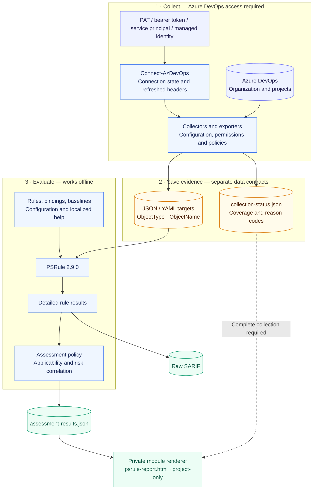
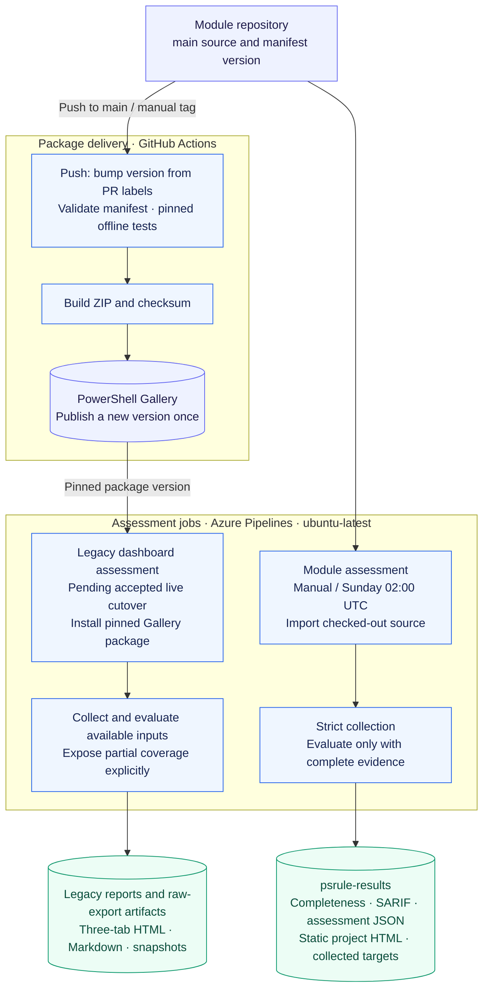

# Repository architecture

This document describes the module source and assessment contracts, including the
module-owned static project report. Older dashboard and ingestion details below
are retained as legacy context, not as the current report implementation.
Pipeline definitions describe intended execution. They do not prove that a pipeline, service connection, or Azure resource currently exists.
The [Project assessment HTML guide](project-health.md) describes the reduced
per-run report and live acceptance gate. The companion workflow is legacy pending
an accepted cutover; source integration does not establish a live update or
authorize repository archival.

## Scope and requirements

The system collects Azure DevOps configuration, evaluates security rules, and presents the results to operators.
It supports project assessments and organization assessments. Operators can evaluate exported data without another connection to Azure DevOps.

The main requirements visible in the implementation are:

- Support multiple authentication methods and permission profiles.
- Bind exported objects to stable rule types and target names.
- Record collection gaps separately from rule failures.
- Provide configurable baselines and localized rule help.
- Publish assessment evidence in pipeline artifacts.
- Provide a portable project HTML snapshot alongside JSON and SARIF. Historical
  dashboards and Azure Monitor Workbooks remain legacy companion features.

The source does not define an assessment latency target, throughput target, or service availability objective.
Assessment duration depends on project count, API calls, and agent capacity.
The static report does not require ingestion.

## Workspace boundaries

Report ownership spans this module repository and a separate legacy companion
repository. The companion is not a dependency of the static HTML implementation.

| Directory | Responsibility |
| --- | --- |
| `DevOpsTools.AzureDevOps.PSRule/` | PowerShell module, collectors, rules, tests, delivery pipelines, and the static project HTML report. |
| `PSRule.Dashboards.AzureDevOps_/` | Legacy three-tab dashboard, assessment scripts, Bicep resources, and Azure Monitor Workbooks; pending accepted live cutover. |
| Each repository's `.worktrees/` | Isolated development checkouts; these are not production components. |
| `.agents/` | Shared development workflows. It is not part of the assessment runtime. |

Dashboard paths below refer to the dashboard repository root. Rule paths refer to this repository root.
The [dashboard architecture](../../PSRule.Dashboards.AzureDevOps_/docs/architecture.md) describes its runtime and report contracts.
That cross-repository link works in this workspace. It requires the same directory layout when used elsewhere.

## Component and data flow

Collection requires Azure DevOps access. Saved targets can be evaluated offline.
Coverage metadata stays outside rule inputs; it is not a rule target. The public
`Export-AzDevOpsAssessmentRun` accepts optional `HtmlOutputPath` and
`CollectionStatusPath` parameters. It keeps its existing JSON and return value,
and invokes the private `Functions/AssessmentHtml.ps1` renderer only when HTML is
requested with complete collection. Organization-root findings remain in SARIF,
outside the existing project projection and HTML. No new public renderer or
assessment schema is introduced.

### Module loading and authentication

The manifest and loader reside in `src/DevOpsTools.AzureDevOps.PSRule/`.
The loader initializes module connection state and imports scripts from `Classes/` and `Functions/`.
PSRule discovers the rule definitions under `rules/`.

`Connect-AzDevOps` creates an `AzureDevOpsConnection` instance and stores it in module state.
Collectors use this connection for authentication. The class supports PAT, bearer, service-principal, and managed-identity authentication.
Token refresh and header construction belong to the connection class.

`FullAccess`, `ReadOnly`, and `FineGrained` describe permission profiles. These profiles are distinct from authentication methods.
Collectors can report unavailable coverage when a profile cannot access a required API.

### Collection and export

`Functions/DevOps.<Area>.ps1` groups retrieval and export functions by Azure DevOps object type.
The module loader also defines the aggregate project and organization exporters.
Project export dispatches collectors for repositories, policies, pipelines, environments, groups, service connections, variable groups, and organization settings.
Organization export discovers projects and creates a directory for each project.

Aggregate export attempts the remaining collectors after a collector fails.
Collection status records distinguish successful collection, empty collections, restricted coverage, and failed collection.
With `-Strict`, aggregate export rejects incomplete required coverage after collecting available evidence.
The completeness report must remain outside the rule input directory.

See [assessment completeness](assessment-completeness.md) for the status schema and reason codes.

### Rule input contract

Exported objects carry `ObjectType` and `ObjectName` properties.
`rules/Config.Rule.yaml` binds `ObjectType` to the PSRule target type.
It prefers `ObjectName` for the target name, with `name`, `displayName`, and `id` as fallback properties.
The binding also exposes `id` and `name` as result fields.

Rule scripts declare their target type, identifier, level, and tags.
Baselines select applicable rules and configuration defaults. Caller configuration can override thresholds.
English help resides in `en/`. Dutch help resides in `nl/` and does not cover every rule.

The exported JSON is the boundary between collection and evaluation.
Changes to object metadata can affect rule selection, target identity, tests, and workbook filters.

## Delivery and assessment pipelines

The module publication workflow runs on pushes to `main` and can also validate
an explicit version tag manually. Push runs bump the runner's manifest from the
higher of the source and latest stable Gallery versions: minor by default, with
merged-PR labels `major` and `patch` as overrides; conflicting labels fail.
It then validates the manifest, runs pinned offline tests, builds the package
and checks the Gallery before publishing. No source commit or Git tag is created.
Manual runs retain the tag's declared version and the opt-in `publish` input.
See [module releases](releases.md) for retry behavior and label rules.
Azure Artifacts publication is retired.

| Entry point | Execution and outputs |
| --- | --- |
| Module `pipelines/psrule-assessment.yml` | Static-report implementation. Microsoft-hosted `Azure Pipelines`, `ubuntu-latest`; manual or Sunday 02:00 UTC. Imports checked-out source, authenticates with the service principal, exports with strict completeness and evaluates `Baseline.Default`. Publishes `outputs/psrule-report.html` beside JSON, collection status, and SARIF in `psrule-results` (or a retained timestamp subdirectory). Publication uses `always()`; incomplete collection stops evaluation and HTML generation. |
| Legacy dashboard `azure-pipelines/run-assessment.yml` | Companion workflow pending accepted live cutover, not required for static HTML. Its source describes a hosted manual/daily assessment using a pinned Gallery package, available exports, three-tab HTML, and retained history. This is not verification of its live definition or schedule. |

The assessments remain independent entry points until a separately authorized
cutover. Publication does not trigger an assessment automatically. The dashboard's
Bicep, workbook publishing, and history utilities remain legacy operator paths;
none is migrated into the static report. Preserve their historical evidence and
resources until a separate retention and retirement decision.

### Static project reporting and legacy handover

This repository owns collectors, rule evaluation, localized remediation help,
assessment JSON, and the minimal HTML renderer. The HTML embeds CSS only: no
JavaScript, external assets, network dependency, or HTML Reports extension. It
shows run metadata, four diagnostic outcomes, the existing nullable SecurityScore,
and Fail/Unknown findings. Evaluated pass rate is Pass / (Pass + Fail), not overall
compliance or a security score; Unknown and NotApplicable remain explicit.

The legacy companion retains its three-tab reporter, effort configuration,
templates, and historical artifact acquisition. Those features are intentionally
not migrated. Accept an authorized real run and the reduced functionality before
disabling the old workflow or archiving its repository. Neither offline tests nor
definition numbers prove a live cutover. Resource teardown is separately approved.

The following classic-run account is retained historical evidence, not validation
of the module-owned HTML or the current live pipeline configuration.

Existing classic definition **17**, revision **15**, generated and published
**Project Health & Compliance** in report-only run **121**. The job executed this
module's `fix/assessment-trust` source at
`164726afbb48861b9abad768834fd9ba17f524d8` on the container's registered agent.
It retained collection status, SARIF, Markdown, HTML, normalized snapshot and
history artifacts. Report-only success does not establish Monitor ingestion.

The legacy display uses schema 2.0; stored snapshots/history remain 1.0. Missing coverage,
legacy failures-only evidence and incompatible identities/configurations cannot
establish improvement. Effort is external reviewed configuration, separate from
rule severity. Without usable estimates in scope, the UI hides effort-dependent
content and ranks using measured findings. These are legacy dashboard semantics,
not features of the static project report. See the [HTML guide](project-health.md)
for the module-owned report contract and acceptance gate.

## GitHub workflow structure

| Definition | Trigger | Responsibility |
| --- | --- | --- |
| `.github/workflows/module-ci.yml` | Selected source and test paths on PRs to `main` and pushes to `main`. Push filters are narrower than PR filters. | Hosted Ubuntu job using the shared pinned Unit runner, NUnit results, coverage and retained diagnostics. ScriptAnalyzer is disabled. |
| `.github/workflows/publish-on-release.yml` | Push to `main` or manual version tag. | Push: bump the package version (minor default, PR labels override), validate and publish. No Git writeback. Manual tags are not bumped; publication is opt-in and existing Gallery versions are skipped. |
| `.github/workflows/wiki.yml` | Published release or manual dispatch. | Copy README, English rule help, and top-level Markdown docs. Generate command help with PlatyPS. Commit and push the wiki. |
| `.github/workflows/psrule-monitor.yml` | Daily at 06:00 UTC or manual dispatch. | Legacy organization export and PSRule.Monitor publication with a shared workspace key. Its export call omits the currently mandatory organization arguments. |

CI invokes the same pinned Unit runner used locally. Live Integration and
Authentication selections remain explicit. `tests/requirements.psd1` pins PSRule
and Pester; routine module CI does not require live Azure DevOps credentials.

## Decisions and technology rationale

These records describe observed implementation choices. They do not claim historical stakeholder approval.

- [ADR-001: Separate collection from evaluation](adr/0001-separate-collection-from-evaluation.md).
- [ADR-002: Retain collection completeness as separate evidence](adr/0002-record-collection-completeness.md).
- [ADR-003: Provide run reports and historical workbooks](adr/0003-publish-run-reports-and-workbooks.md).

PowerShell matches the existing module, operator scripts, and Pester tests.
PSRule supplies rule discovery, binding, baselines, and result formats.
Bicep describes legacy Azure resources and workbook content; Log Analytics
supports that legacy history path. The module-owned static HTML supplies a
portable project snapshot without either system or a separate report web server.
The ADRs above remain historical records, not promises of feature parity.

## Security, operation, and failure modes

| Boundary or failure | Effect | Existing control or remaining gap |
| --- | --- | --- |
| Insufficient API access | Missing assessment inputs. | The module pipeline rejects incomplete strict collection before projection/HTML. The legacy dashboard has separate partial-coverage behavior. |
| No usable input or results | A report could imply successful coverage without evidence. | The module pipeline rejects zero rule results; HTML shows explicit empty project/finding states and unavailable rates/scores. Missing evidence is not a pass; engine, projection, and rendering errors remain errors. |
| Stale current report | An incomplete recollection could appear successful. | Owned-file cleanup includes `psrule-report.html`; incomplete strict collection retains status instead of generating HTML. Retained runs and unrelated files survive. |
| Legacy Azure ingestion failure | Workbook history can remain absent or partial. | Legacy publisher utilities retry transient failures and verify record counts. The daily dashboard uses retained pipeline artifacts. |
| Legacy duplicate ingestion | Workbook history can contain duplicate records. | Legacy count checks reject excess records without removing duplicates. The daily dashboard selects compatible run snapshots. |
| Agent capacity unavailable | Manual and scheduled jobs wait for hosted capacity. | Assessment jobs use `Azure Pipelines` with `ubuntu-latest`; no container listener is required. |
| Artifact expiration | Run snapshots become unavailable. | Azure DevOps run retention controls artifacts. Operators must retain or download required evidence. |
| Sensitive assessment data | Target identities and exported configuration can expose organizational information. | Restrict pipeline, artifact, variable-group, and workspace access. HTML encodes display values and excludes raw payloads/reasons, but the module artifact staging directory includes collected targets. Encoding does not replace access control. |
| Package or branch drift | Different pipelines can evaluate different module versions. | The module assessment imports checked-out source; the dashboard installs a pinned Gallery package. Record both the source revision and package version. |
| Legacy workflow drift | Older paths can fail against the current module API. | The GitHub Monitor export call requires review before operational use. Documentation does not fix this code. |

Protected variable groups and Azure service connections supply credentials for Azure pipelines.
GitHub workflows use repository secrets. The manual ingestion path obtains audience-specific bearer tokens through Azure CLI.
Resource permissions and service-connection identities require configuration outside these YAML files.

The current workbook template enables public ingestion and query endpoints.
It configures 30-day workspace and table retention, with no daily ingestion quota.
These are source settings, not a statement about a deployed resource's current configuration.
Azure ingestion, retention, and hosted agent usage can incur costs.

## Validation and review boundaries

This document follows module source, pipeline YAML, workflow YAML, and dashboard scripts.
Documentation checks cover file links and patch formatting. They do not execute live assessments or deployments.
The existing architecture review and deployment status documents remain separate evidence.
Stakeholder review can resolve the operational gaps above and approve any future changes.

### Source entry points

- [Module loader](../src/DevOpsTools.AzureDevOps.PSRule/DevOpsTools.AzureDevOps.PSRule.psm1), [connection](../src/DevOpsTools.AzureDevOps.PSRule/Classes/AzureDevOpsConnection.ps1), and [bindings](../src/DevOpsTools.AzureDevOps.PSRule/rules/Config.Rule.yaml).
- [Module publication workflow](../.github/workflows/publish-on-release.yml) and [weekly assessment pipeline](../pipelines/psrule-assessment.yml).
- [Module CI](../.github/workflows/module-ci.yml), [Gallery publication](../.github/workflows/publish-on-release.yml), [wiki publication](../.github/workflows/wiki.yml), and [legacy Monitor workflow](../.github/workflows/psrule-monitor.yml).
